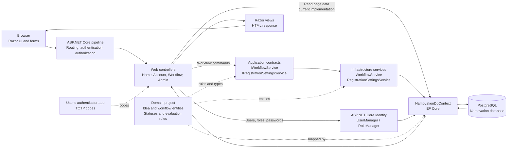
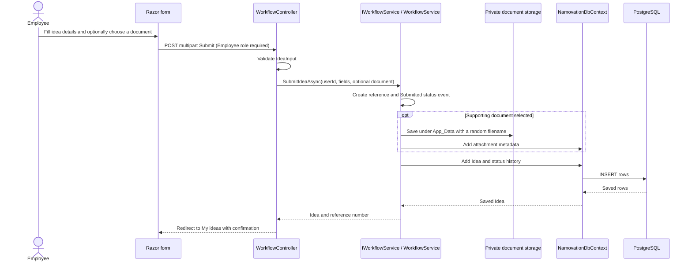
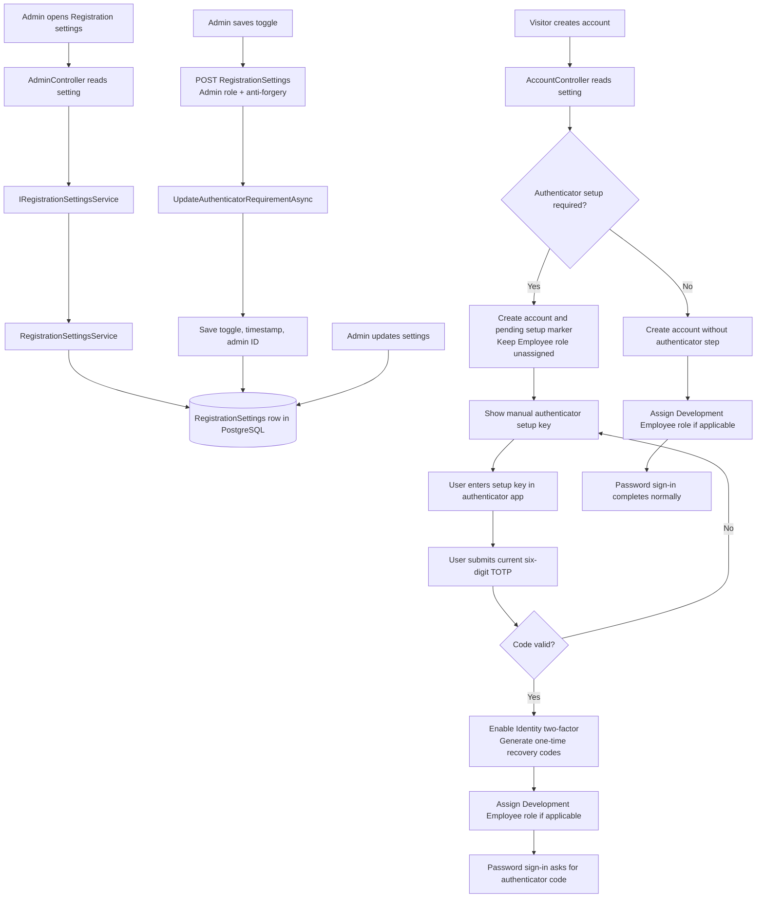

# Namovation application architecture

This guide describes the current implementation: how a browser request moves through the application, where business rules live, and how data reaches PostgreSQL. It is based on the code in this repository.

## 1. The application at a glance

Namovation is a modular monolith: one ASP.NET Core web application is deployed, with responsibilities separated into four .NET projects. The projects share types through references; they are not separate network services.

### Request and response cycle

1. A browser requests a page or submits a form.
2. ASP.NET Core routes the request. Authentication identifies the signed-in user, and authorization checks the controller action's role requirements.
3. The controller validates form input and either reads page data or invokes a business operation.
4. EF Core and Npgsql translate database operations into PostgreSQL queries and updates.
5. The controller returns a Razor view or redirects to another page with a success/error message.

The browser never connects directly to PostgreSQL. Database credentials stay on the server.

## 2. Why the solution has four projects

| Project | What belongs there | Why it exists |
| --- | --- | --- |
| `Namovation.Domain` | `Idea`, `Screening`, `BoardEvaluation`, `IdeaCompilation`, `MonthlyCompilation`, `IdeaStatusEvent`, `RegistrationSettings`, enums, and `EvaluationRules` | Defines the business concepts and rules without depending on MVC or PostgreSQL. |
| `Namovation.Application` | `IWorkflowService`, `IRegistrationSettingsService`, `IIdeaDocumentStore`, and `WorkflowException` | Defines operations that the Web layer needs without tying it to a specific implementation. |
| `Namovation.Infrastructure` | `WorkflowService`, `PrivateIdeaDocumentStore`, `RegistrationSettingsService`, `NamovationDbContext`, `NamovationUser`, and EF Core migrations | Implements data access, private file storage, Identity persistence, and application service contracts using PostgreSQL. |
| `Namovation.Web` | `Program.cs`, controllers, view/input models, Identity UI, Razor views, and CSS | Handles HTTP requests, role authorization, form validation, and user-facing pages. |

The project references point inward toward the domain: Application references Domain; Infrastructure references Application and Domain; Web composes them through dependency injection in `Program.cs`.

## 3. Controllers: HTTP entry points

Controllers translate HTTP requests into application operations. They handle routing, authorization, input validation, choosing a view or redirect, and user-facing messages. They should not be the only place business rules are enforced; workflow constraints are also checked in `WorkflowService`.

| Controller | Access | Main actions and responsibility |
| --- | --- | --- |
| `HomeController` | Signed-in and anonymous | `Index` builds the public home page or a role-aware dashboard. It currently reads dashboard counts from `NamovationDbContext`. `Privacy` and `Error` serve standard pages. |
| `AccountController` | Anonymous for sign-in/registration; setup requires the pending account's authenticated session; Development-only for first Admin setup | `Login` checks credentials and lockout state, then signs in through Identity. Accounts with authenticator enabled go to `LoginWithAuthenticator`. `Register` creates an account and, when required by Admin settings, starts authenticator enrollment. `SetupAuthenticator` validates the initial TOTP code and enables two-factor sign-in. `SetupFirstAdmin` creates the initial local admin once. |
| `WorkflowController` | Requires sign-in; individual actions require Employee, InnovateManager, or InnovateBoard | Employee actions: `Mine`, `Submit`. Manager actions: `Manager`, `Screen`, `Forward`, `CompileReview`, `Compile`, `RewardDecision`. Board actions: `Board`, `Evaluate`. |
| `AdminController` | Admin role only | `Users`, `CreateUser`, and `SetRoles` manage accounts and roles. `RegistrationSettings` reads and saves whether new public registrants must enroll an authenticator. |

Every state-changing MVC action uses POST plus anti-forgery validation. Role attributes enforce access on the server; hiding navigation links is only a UI convenience.

## 4. Business logic and data flow

### Employee submits an idea

`IdeaInput` is an HTTP form model with validation attributes. It is not the database entity. `WorkflowService` creates the domain `Idea`, generates a unique reference, sets its initial status, creates its first status-history event, and persists both. An optional PDF, Word, Excel, PowerPoint, or text document (maximum 10 MB) is stored outside `wwwroot`; only its random storage name and metadata go into `IdeaAttachments`. Download authorization allows the submitting employee, Innovate Managers, and board members while the idea is in `BoardEvaluation`.

### Manager screens and forwards ideas

1. `WorkflowController.Manager` queries submitted ideas, monthly batches, ideas ready to compile, and repository results to construct `ManagerPage`.
2. The manager opens a submission and chooses Repository 1 or Shortlist.
3. `WorkflowController.Screen` passes the action to `WorkflowService.ScreenAsync`.
4. The service requires the idea to be `Submitted`. A shortlist requires an anonymized title and description, adds the idea to the compilation for its submission month, and changes status to `Shortlisted`. A non-shortlist is assigned Repository 1.
5. `ForwardMonthAsync` forwards shortlisted ideas in a monthly batch. For an initial forward, it verifies every idea in the batch has been screened, then marks the batch forwarded. If the batch was already forwarded, only newly shortlisted ideas are advanced and the batch remains forwarded; this is the explicit addendum-forward action. In both cases, ideas change to `BoardEvaluation` only after the manager submits that action. Unreviewed ideas that were auto-advanced by the former addendum behavior are returned to `Shortlisted` for explicit forwarding.

### Board evaluates, manager compiles

1. `WorkflowController.Board` returns ideas in `BoardEvaluation` to a basic grid. Each row opens a details modal with the applicant-submitted title, problem/opportunity, description, expected benefit, attachment download when present, and the current board member's scoring form. The board view does not display submitter identity. Board attachment downloads are permitted only while an idea remains in `BoardEvaluation`.
2. `Evaluate` validates the five scores; `WorkflowService.EvaluateAsync` also checks the idea status, score range 1–10, duplicate member evaluation, and maximum of three board evaluations. A serializable transaction and unique database index help prevent duplicate evaluation records.
3. Once three evaluations exist, the manager can open `CompileReview`. `CompileAsync` verifies exactly three evaluations, calculates the average of their totals (maximum 50), and creates the compilation result.
4. An average below 40 is filed in Repository 2. An average of 40 or more is marked eligible, but it is not automatically rewarded.
5. `RewardDecision` records Rewarded, Appreciated, or NotSelected. Rewarded/Appreciated maps to Repository 3. The current business logic does not assign a repository for NotSelected; the source requirements leave that disposition unspecified.

## 5. Registration, Identity, and admin settings

`RegistrationSettingsService` reads and writes a singleton database row (`Id = 1`). The initial migration inserts `AuthenticatorSetupRequired = true`; a follow-up migration renames the earlier email-verification column. The setting affects new public registrations only. When setup is required, the account has no Employee role while enrollment is pending. Authenticator keys and recovery codes use Identity's `AspNetUserTokens` table. No SMTP service, external account, or API key is used. Admin-created accounts are provisioned directly and are outside this self-registration setting.

ASP.NET Core Identity uses the `AspNetUsers`, `AspNetRoles`, and `AspNetUserRoles` tables. `UserManager` hashes passwords, manages accounts, stores authenticator keys, validates TOTP codes, and generates recovery codes; `RoleManager` manages roles. At sign-in, `PasswordSignInAsync` returns a two-factor challenge for enrolled users, then `TwoFactorAuthenticatorSignInAsync` validates their code. This checks possession of an authenticator, not ownership of the account email address.

## 6. Important business and database files

| File | Why it is needed |
| --- | --- |
| `Namovation.Domain/Workflow.cs` | Workflow entities, status/repository/outcome enums, and score constants/rules. |
| `Namovation.Domain/RegistrationSettings.cs` | Persistent, singleton registration policy entity. |
| `Namovation.Application/WorkflowService.cs` | Contract for workflow operations, separating callers from the implementation. |
| `Namovation.Application/IRegistrationSettingsService.cs` | Contract for reading and updating registration policy. |
| `Namovation.Infrastructure/Services/WorkflowService.cs` | Enforces state transitions, validation, scoring, and repository decisions. |
| `Namovation.Infrastructure/Services/RegistrationSettingsService.cs` | Reads and updates the settings row in PostgreSQL. |
| `Namovation.Infrastructure/Data/NamovationDbContext.cs` | Maps Identity and domain entities to tables, relationships, indexes, and constraints. |
| `Namovation.Infrastructure/Data/NamovationUser.cs` | Adds display name, designation, and location to the Identity account. |
| `Namovation.Infrastructure/Migrations/` | Versioned SQL schema changes. `InitialPostgresSchema` creates the initial tables; `AddRegistrationSettings` adds and seeds the registration-setting row. |
| `Namovation.Web/Program.cs` | Registers services, PostgreSQL, Identity, rate limiting, middleware, routes, and application roles. |
| `Namovation.Web/Models/` | Input models and view models; isolates form fields and display projections from persistence entities. |
| `Namovation.Web/Controllers/AccountController.cs` | Registration, authenticator enrollment, two-factor login, recovery-code login, and first-admin setup. |
| `Namovation.Web/Areas/Identity/Pages/Account/` | Redirects Identity's default Register and Login routes to the custom MVC pages so the shared application UI and enrollment flow are used. |

## 7. Views and page models

Razor views under `Namovation.Web/Views` render the UI for each controller. `Views/Shared/_Layout.cshtml` provides the common navigation and page shell; `wwwroot/css/site.css` contains the visual theme. View models such as `IdeaRow`, `BoardIdeaRow`, and `ManagerPage` control which fields reach each screen. In particular, board projections deliberately omit submitter identity and original submission text.

`Views/Account/SetupAuthenticator.cshtml` displays a private manual setup key for Microsoft Authenticator or another TOTP-compatible app. `Views/Account/AuthenticatorSetupComplete.cshtml` displays one-time recovery codes after successful enrollment. `Views/Account/LoginWithAuthenticator.cshtml` handles authenticator-code or recovery-code sign-in. `Areas/Identity/Pages/Account/Register.cshtml` and `Login.cshtml` redirect Identity's standard routes to the custom MVC pages.

## 8. Current architecture boundary and next refinement

This is intentionally a practical first modular monolith, not a fully isolated Clean Architecture implementation. Workflow writes and registration-setting updates go through Application interfaces and Infrastructure services. Some read-only page queries in `HomeController`, `WorkflowController`, and Identity-backed Admin actions currently use `NamovationDbContext`/`UserManager` directly from Web. If the project grows, those reads can move behind Application query services. That would make the Web layer depend on contracts only and make query behavior easier to test independently.

For table relationships and unique constraints, see [database-design.md](database-design.md). For the business workflow and its unresolved policy decisions, see [requirements-and-architecture.md](requirements-and-architecture.md).
