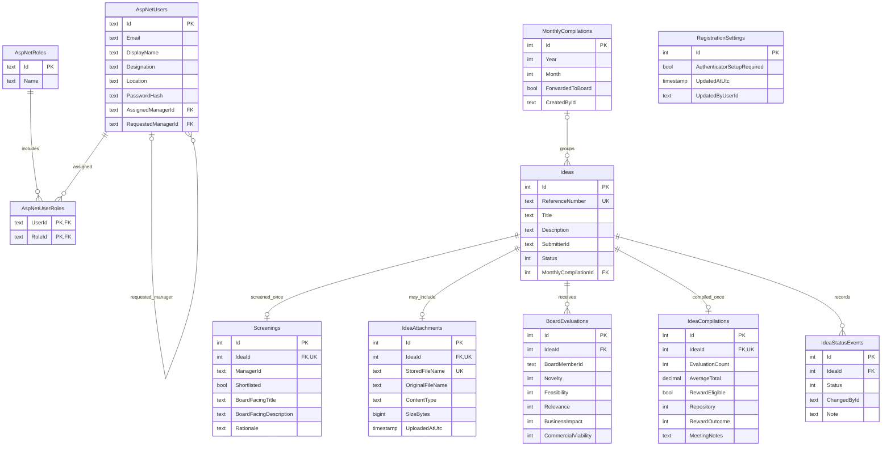

# Namovation database design

This document describes the schema currently implemented by the EF Core model and PostgreSQL migrations. PostgreSQL stores the application data; ASP.NET Core Identity tables store users and role assignments.

## Entity relationship diagram

`PK` is a primary key, `FK` is a foreign key, and `UK` indicates a unique constraint or unique index. The diagram focuses on the relationships represented by database constraints. Identity also creates supporting tables for claims, logins, and tokens.

## Tables and why they exist

| Table | Purpose in the workflow |
| --- | --- |
| `AspNetUsers` | Identity accounts, password hashes, email, display name, designation, location, current manager, and pending manager request. Passwords are stored as hashes by Identity. |
| `AspNetRoles` | The named application roles: Employee, InnovateManager, InnovateBoard, and Admin. |
| `AspNetUserRoles` | Join table mapping users to roles. Its composite primary key `(UserId, RoleId)` prevents duplicate membership. |
| `MonthlyCompilations` | A manager's monthly batch of shortlisted ideas. The unique `(Year, Month, CreatedById)` index allows a separate batch per manager each month; `ForwardedToBoard` records whether it was sent. |
| `Ideas` | The canonical/original employee submission and its current status. Optional `MonthlyCompilationId` associates a shortlisted idea with its month. |
| `IdeaAttachments` | Optional one-per-idea metadata for a supporting document. File contents are stored under `Namovation.Web/App_Data/IdeaDocuments`, outside the public static-file folder; the database stores the random storage name and display metadata. Employees and managers can download it; board members can download it while the idea is in `BoardEvaluation`. |
| `Screenings` | The manager's one screening decision per idea, optional note, and board-facing description. These remain separate from the original submission. The legacy `BoardFacingTitle` column is retained but unused. |
| `BoardEvaluations` | One board member's five scores and submission time for one idea. Multiple rows preserve independent evaluations. |
| `IdeaCompilations` | The manager's compiled average and final eligibility/meeting/repository fields. This is separate from the individual board scores. |
| `IdeaStatusEvents` | Status-change history with actor ID, time, and optional note, retained alongside the current status on `Ideas`. |
| `RegistrationSettings` | One singleton row stores whether public self-registration requires authenticator setup, when the value changed, and the admin user ID that changed it. The initial migration inserts row `Id = 1` with setup required. |

## Relationships and cardinality

- A **monthly compilation** can contain zero or many ideas; an idea can have no compilation or belong to one compilation. The foreign key is `Ideas.MonthlyCompilationId`. Deleting a batch sets the idea's compilation ID to null rather than deleting the idea.
- An **idea** can have zero or one screening. `Screenings.IdeaId` is unique, so a second screening row for the same idea is rejected by PostgreSQL.
- An **idea** can have many board evaluations. The unique `(IdeaId, BoardMemberId)` index permits at most one evaluation per board member per idea.
- An **idea** can have zero or one compilation result. `IdeaCompilations.IdeaId` is unique.
- An **idea** can have many status-history events.
- An **idea** can have zero or one supporting attachment. The unique `IdeaAttachments.IdeaId` index enforces one optional file per idea.
- `RegistrationSettings` is a singleton configuration record, constrained to `Id = 1`; it has no foreign-key relation to workflow rows. The update actor is stored as an Identity user ID string, as with other workflow actor fields.
- Identity stores authenticator keys and recovery codes in `AspNetUserTokens`, keyed by user, provider, and token name. A registration-pending marker also uses that table; no custom OTP storage table is needed.
- A **user** can hold multiple roles, and a **role** can be assigned to many users. `AspNetUserRoles` implements this many-to-many relationship with foreign keys to both Identity tables.
- A self-registering user receives the Employee role. `AssignedManagerId` stores the approved manager, while `RequestedManagerId` stores a pending request. Each field references another Identity user; managers approve requests from their workspace. An employee can register without selecting a manager and request one later.
- Managers see new submissions only from employees currently assigned to them. Screened ideas remain with the manager who screened them, and monthly batches are separate by manager.

## How the schema enforces workflow rules

1. When an employee submits an idea, `WorkflowService.SubmitIdeaAsync` inserts an `Ideas` row with a unique reference number and the initial `Submitted` status. It also inserts the first `IdeaStatusEvents` row.
   If a supporting document is supplied, the service stores the file outside `wwwroot` and inserts one `IdeaAttachments` metadata row. The download action permits the submitting employee and Innovate Managers, plus board members while the idea is in `BoardEvaluation`. The board UI shows applicant-submitted idea details and the supporting document, while omitting submitter identity.
2. When a manager screens it, `ScreenAsync` creates the `Screenings` row. A shortlist stores anonymized board-facing fields and attaches the idea to its submission month's `MonthlyCompilations` batch. A non-shortlisted idea receives a Repository 1 result in `IdeaCompilations`.
3. When the manager forwards a month, `ForwardMonthAsync` marks the batch as forwarded and changes its shortlisted ideas to `BoardEvaluation`.
4. Each board submission inserts one `BoardEvaluations` row. Service validation checks score bounds, that the idea is open for evaluation, that the member has not already evaluated it, and that fewer than three evaluations exist. The database's unique `(IdeaId, BoardMemberId)` index provides an additional duplicate guard.
5. Once there are exactly three evaluation rows, `CompileAsync` computes the average of their totals and inserts one `IdeaCompilations` row. Below 40/50 is assigned Repository 2. A score of 40/50 or higher is marked eligible and waits for the meeting decision.
6. `DecideRewardAsync` records the meeting outcome and optional notes in `IdeaCompilations`. Rewarded or Appreciated assigns Repository 3. `NotSelected` currently receives no repository assignment because the source requirements do not say where it belongs.
7. The Admin registration-settings page updates the singleton `RegistrationSettings` row. When authenticator setup is required, a new self-registered user has no Employee role until they enroll and confirm an authenticator code. When setup is optional, registration proceeds without enrollment. Existing accounts are not changed by the toggle.

## Physical repositories vs. repository values

Repository 1, 2, and 3 are workflow classifications, not separate PostgreSQL tables. They are represented by `RepositoryKind` in `IdeaCompilations.Repository`; the corresponding current workflow stage is also represented by `Idea.Status`. Keeping them as values lets the app retain one idea record as it moves through the process.

## User ID references in workflow records

Workflow rows store actor identifiers such as `Ideas.SubmitterId`, `Screenings.ManagerId`, `BoardEvaluations.BoardMemberId`, `MonthlyCompilations.CreatedById`, `IdeaCompilations.CompiledById`, and `IdeaStatusEvents.ChangedById`. In the current migration, these are text columns without PostgreSQL foreign-key constraints to `AspNetUsers`. The app uses the IDs to associate activity with users, but the database does not prevent an ID from referring to a deleted or missing user. Adding those constraints is a possible schema improvement; it was not silently assumed in the existing migration.

Authenticator enrollment proves the user can generate matching time-based codes from the enrolled authenticator. It does not prove that the email address in `AspNetUsers` belongs to that user.

## EF Core configuration

`NamovationDbContext.OnModelCreating` declares the unique reference, one-per-idea screening and compilation indexes, one-per-member evaluation index, and the one-per-year/month batch index. The initial migration creates the PostgreSQL tables, relationships, and indexes. After changing entity properties or relationships, create and apply a reviewed EF Core migration so the live PostgreSQL schema remains aligned with the model.
